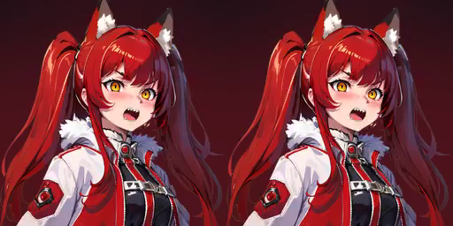

# 🦊 Kitsune

[](https://github.com/lucky-edgelord/Kitsune/actions/workflows/ci.yml)
 

A talking fox-girl bot for the Anime community on [Vector](https://vectorapp.io), built on
[vector-sdk-py](https://github.com/lucky-edgelord/vector-sdk-py). Kitsune is the successor to Neku: she chats
through **Ollama**, speaks with **NovelAI** text-to-speech, and replies with a short **lip-synced video** of her Fox
Mafia avatar. Her expression is picked by a **DistilBERT emotion** model. She also generates anime art with
**NovelAI** image generation.




## How a reply is made

1. Your message and recent history (per user, per channel, in SQLite) go to Ollama with Kitsune's persona
   ([persona/kitsune.md](src/kitsune/persona/kitsune.md)).
2. [`bhadresh-savani/distilbert-base-uncased-emotion`](https://huggingface.co/bhadresh-savani/distilbert-base-uncased-emotion)
   reads her reply: joy/surprise → happy, anger → mad, sadness/fear → sad, love → shy, low confidence → neutral.
3. NovelAI TTS v2 (voice Aurae) voices the reply one sentence at a time; ffprobe times each line for the
   subtitles.
4. Neku's avatar pipeline (ported, see [docs/architecture.md](docs/architecture.md)) picks that mood's four frames (eyes open/blinking × mouth closed/talking), opens the mouth
   with the voice's loudness, blinks every few seconds, and encodes a square MP4 (512×512 by default) with ffmpeg.
   The lines are joined, written as an SRT and burned in with ffmpeg's `subtitles` filter (Neku's pipeline).
5. She replies with just the video. Without a NovelAI token she replies with text only.

## Channels and commands

Kitsune only uses her two channels and **ignores every other channel completely** (messages, mentions and commands).

| Channel | What she does |
|---|---|
| **🤖┊Kitsune Bot** | Just talk: every message gets a talking video with subtitles. Also `!kitsune <message>`, `!forget` (clear your chat history), `!mood <happy\|mad\|neutral\|sad\|shy>`, `!help` |
| **🖼️┊Anime Image Generator** | Type a prompt, or `!image <prompt>`, and she draws it with NovelAI. Also `!help` |

Channels are matched by name (or id) via `KITSUNE_CHAT_CHANNELS` / `KITSUNE_IMAGE_CHANNELS`, so renaming the emoji
part keeps working.

## Setup

Needs Python 3.10+, ffmpeg, the Rust toolchain (vector-sdk-py builds its native module), an Ollama server, and a
NovelAI subscription.

```bash
git clone https://github.com/lucky-edgelord/Kitsune && cd Kitsune
python -m venv .venv && . .venv/bin/activate
pip install -e ".[emotion]"          # drop [emotion] to skip torch; she'll always look neutral
ollama pull llama3.1                 # or any chat model; set OLLAMA_MODEL
cp .env.example .env                 # fill in VECTOR_NSEC, NOVELAI_TOKEN, ...
kitsune check                        # verifies keys, Ollama, ffmpeg
kitsune run
```

Or with Docker (includes an Ollama container): `docker compose up -d`, then
`docker compose exec ollama ollama pull llama3.1`.

`kitsune render "Hello, kit!" --mood auto -o hello.mp4` makes a clip without connecting to Vector.

Give Kitsune her **own** Vector account (a fresh nsec) and invite it to the Anime community.

| Setting | Default | |
|---|---|---|
| `VECTOR_NSEC` | (required) | Kitsune's Vector key |
| `OLLAMA_HOST`, `OLLAMA_MODEL`, `OLLAMA_API_KEY` | `http://localhost:11434`, `llama3.1`, none | key only for ollama.com |
| `NOVELAI_TOKEN` | none | persistent API token; enables voice, video and images |
| `NOVELAI_VOICE_SEED` | `Aurae` | any TTS v2 voice or seed (`seedmix:` works) |
| `NOVELAI_IMAGE_MODEL`, `NOVELAI_IMAGE_SIZE` | `nai-diffusion-4-5-full`, `portrait` | |
| `KITSUNE_CHAT_CHANNELS`, `KITSUNE_IMAGE_CHANNELS` | `kitsune bot`, `anime image generator` | name substrings or ids |
| `KITSUNE_VIDEO_SIZE` | `512` | square video size |
| `KITSUNE_SUBTITLES` | `true` | burn the reply in as subtitles |
| `KITSUNE_LIPSYNC` | `smooth` | `smooth` (24 fps) or `neku` (Neku's 16 fps, 3 mouth levels) |
| `KITSUNE_TALKING_VIDEO` | `true` | `false` for text-only replies |
| `KITSUNE_PREFIX`, `KITSUNE_DATA_DIR` | `!`, `./data` | |

## Project layout

```
src/kitsune/
  app.py              KitsuneBot (vector-sdk-py commands.Bot), loads the cogs
  cogs/               chat.py · images.py · utility.py
  pipeline.py         ReplyPipeline: think -> feel -> speak -> animate (no Vector dependency)
  services.py         builds all backends from Config; swap any of them
  providers/
    llm/              ChatModel protocol · Ollama
    speech/           SpeechSynthesizer protocol · NovelAI TTS
    images/           ImageGenerator protocol · NovelAI images
    emotion/          EmotionDetector protocol · DistilBERT · fixed
  avatar/             sprites.py · lipsync.py · renderer.py
  storage/memory.py   per-user chat history (SQLite)
  persona/kitsune.md  her personality (edit freely)
  assets/sprites/     Fox Mafia sprites: <mood>/{open,blink}_{closed,talk}.png
tests/                one file per module, no network
```

More in [docs/architecture.md](docs/architecture.md). Contributing: [CONTRIBUTING.md](CONTRIBUTING.md).

Kitsune is a community project and is not affiliated with Vector, NovelAI, Ollama or Hugging Face.
